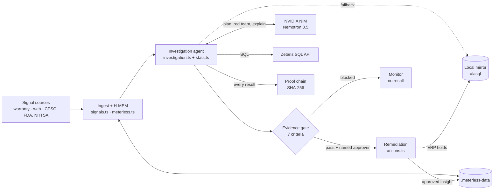
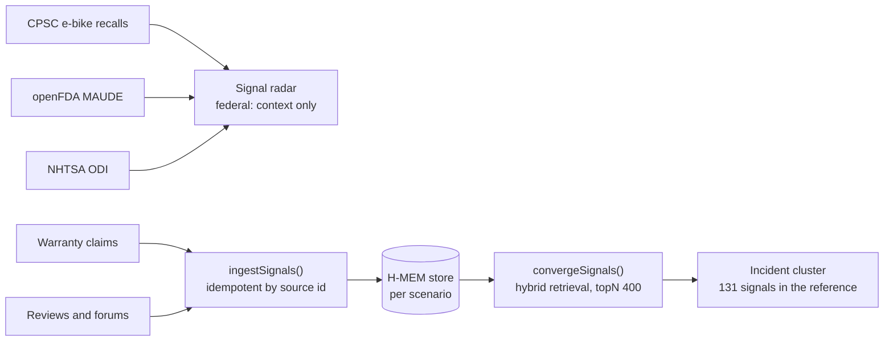
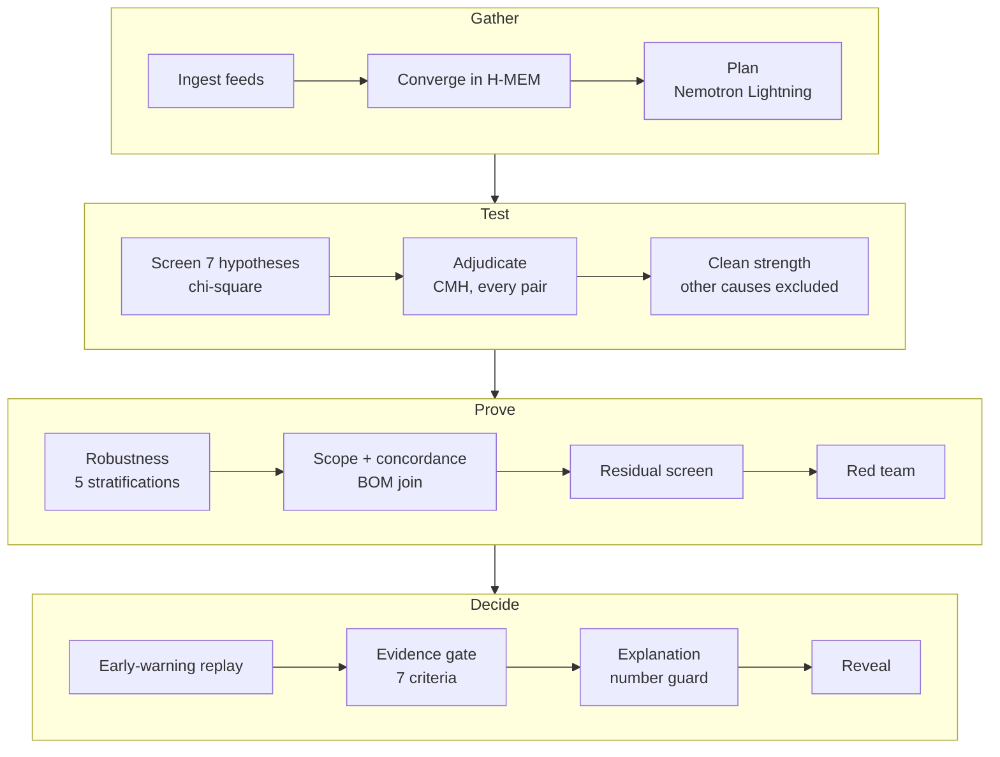
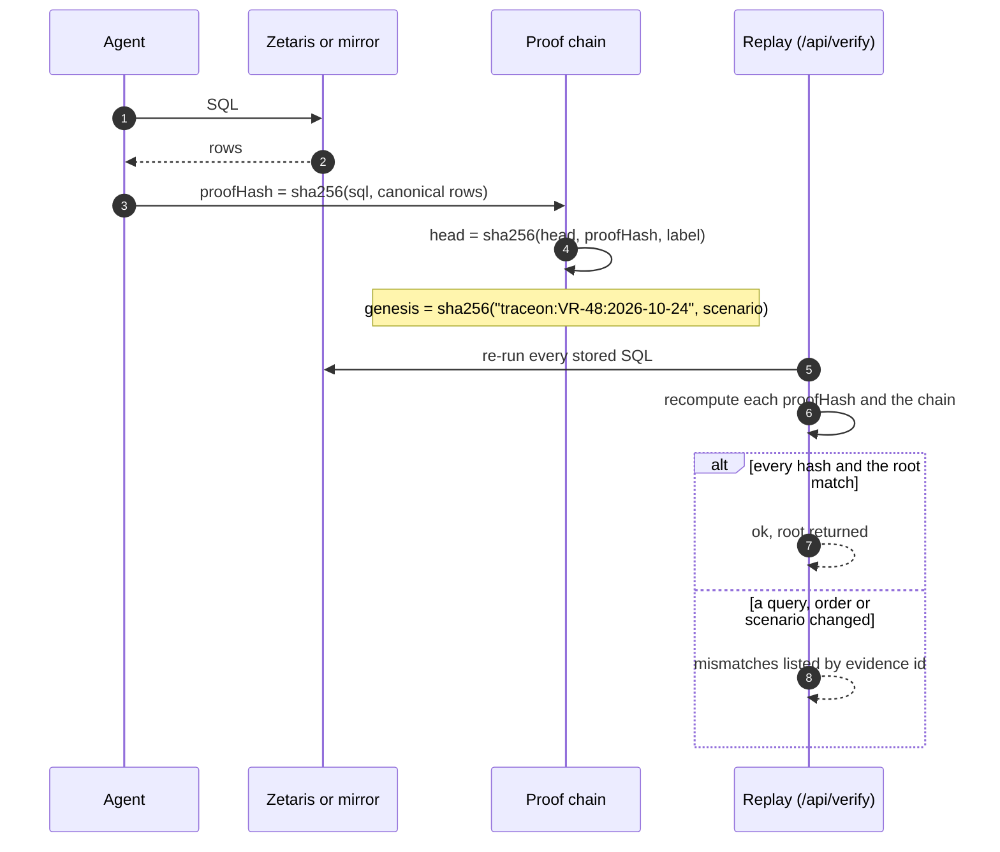
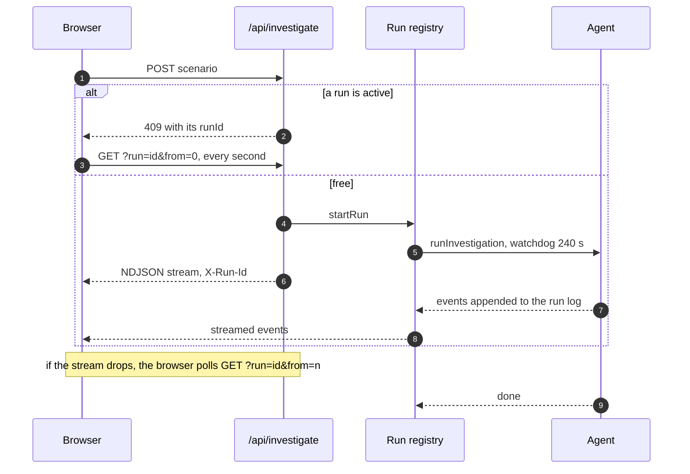

# Traceon architecture

This document describes the code as it is. File paths point to where each piece lives. The [README](README.md) is the short version for judges.

## 1. The big picture

**One process, three kinds of state.** Durable memory (H-MEM records, the trust ledger and the lot world model) lives on disk under `METERLESS_STORAGE_DIR`. The federated mirror, the ERP hold table and the run registry live in process memory, pinned to `globalThis` by `src/lib/singleton.ts` so every route bundle sees the same objects. The Nemotron reply cache lives in `.nim-cache/`. That is why the app wants one long-running Node host rather than serverless functions.

## 2. Data and scenarios

`src/lib/enterpriseData.ts` generates a fictional battery maker, **VoltRide**, and its VR-48 48V e-bike pack:

| Table | Rows | Silo it stands for |
| --- | --- | --- |
| `erp_production_lots` | 60 | ERP and plant manufacturing execution system |
| `supplier_bom_lineage` | 60 | Supplier portal (bill of materials) |
| `unit_fact` | 180,000 | Federated view: ERP x BOM x firmware telemetry x warehouse |
| `warranty_claims` | depends on scenario (125 in the reference) | Service cloud |
| `warehouses` | 7 | Warehouse management system |

Generation is seeded (`mulberry32(409)`), so the same scenario always produces identical rows. That is what makes proof hashes reproducible.

**Scenarios.** `resolveScenario()` turns an id into planted causes:

| Id | Planted cause | Built-in trap |
| --- | --- | --- |
| `reference` | Cell batch `CB-B-0917` in lot L-409 fails at 9% | L-409 shipped 72% to Sun Belt warehouses, so heat looks guilty; the batch's plant, supplier and BMS board look guilty too |
| `firmware` | Firmware v3.4 overcharges (rate 0.0018, ramps with time in field) | v3.4 rolled out first in the Sun Belt, so heat looks guilty |
| `two-causes` | The reference batch and firmware v3.4 together | Each cause inflates the other's baseline |
| `noise` | None; baseline rate 0.0006 | About 100 complaints with no structure |
| `random-<seed>` | Drawn from batch, firmware, plant, carrier, BMS board, two causes or none | The description stays hidden until the verdict |

The reference scenario keeps its historical random stream and plant-to-supplier mapping, so its published numbers never move. Other scenarios assign suppliers independently of plants (`supplierFor()`), so a plant defect and a supplier defect are distinguishable. `scenarioTruth()` exposes the planted causes, and only `runInvestigation()`'s final `reveal` event reads it.

## 3. Signals and memory

- **Feeds** (`src/lib/signals.ts`): each federal fetch has a 9-second timeout and returns `status: 'unreachable'` with no items on failure. Nothing is ever substituted. Bright Data's Web Unlocker is called only with `BRIGHTDATA_API_TOKEN` and only for the reference scenario; otherwise the simulated chatter is labelled `simulated`.
- **H-MEM** (`src/lib/meterless.ts`, engine in `vendor/meterless-hmem`): every product signal becomes a `factual` short-term memory with its channel as provenance. Retrieval uses the engine's hybrid score (semantic, keyword, tags, entities, layer, recency, multiplied by confidence) with threshold 0.18. Recency is scored as of the dataset date (`AS_OF`, 2026-10-24) rather than the wall clock, so the converged count is stable across days.
- **Approved insights.** When a human approves a remediation, `commitRootCauseInsight()` writes a long-term memory with `derivedFrom` lineage to the converged signals. The next investigation's `priorInsights` recalls it.
- **Lot world model.** `updateWorldModel()` keeps a risk state per lot. A quarantine is sticky: re-running an investigation never un-quarantines a lot.
- **Markovian chain.** `runBoundedChain()` runs the 13 investigation steps through the vendored Markovian orchestrator. Each step sees only a compact JSON carryover (ruled-out ids, leads, confirmed causes), bounded at 512 tokens.

## 4. The statistics engine

`src/lib/stats.ts` holds every number the agent acts on. The model never produces one.

| Function | What it computes | Checked against |
| --- | --- | --- |
| `chiSquarePValue` | Upper tail of chi-square, computed in log space (Lanczos log-gamma, series and continued fraction) so p-values like 1e-300 never underflow | scipy `chi2.sf` / `chi2.logsf` |
| `chiSquareIndependence` | k x 2 test of failure rate across groups | scipy `chi2_contingency(correction=False)` |
| `monteCarloP` | Exact p-value by redistributing failures 20,000 times, seeded from the table | Determinism and conservativeness tests |
| `cochranMantelHaenszel` | Is exposure still associated with failure once a second factor is held fixed? Continuity-corrected, with the pooled odds ratio | statsmodels `StratifiedTable.test_null_odds(correction=True)` |
| `relativeRisk` | Risk ratio with a Katz log-method 95% interval | scipy `relative_risk(...).confidence_interval` |

**When the chi-square approximation is not trusted.** If more than 20% of expected cells are under 5, or any is under 1, and the asymptotic p is above 1e-6, the Monte Carlo exact test replaces it. This matters: a few baseline failures spread over 60 batches make the approximation report false significance. The reference values are in `tests/fixtures/scipy-reference.json` (generated with scipy 1.18.1 and statsmodels 0.15.0).

## 5. The investigation, step by step

`runInvestigation()` in `src/lib/investigation.ts` emits typed events (`InvestigationEvent`) that the UI folds into state.

1. **Screen.** For each of the seven `DIMENSIONS` (firmware, carrier, climate zone, plant, BMS supplier, cell supplier, cell batch) one SQL `GROUP BY` and a k x 2 test. Bonferroni alpha is `0.01 / 7 = 1.4e-3`. Below it, the hypothesis is a suspect; above it, ruled out.
2. **Adjudicate.** Every suspect's hottest group is re-tested holding every other suspect's hottest group fixed (CMH). A suspect fails if any adjustment pushes it above `alpha / (G - 1)`, where G is the number of groups it was picked from: picking the worst of 60 batches after the fact has to pay for that selection. If no stratum contains both exposed and unexposed units, the two factors are **aliased** (the same units); the more specific one is kept and the other is marked redundant.
3. **Clean strength.** Each survivor's rate and relative risk are recomputed with the other survivors' units excluded, so two real causes do not inflate each other's baseline. A cause must have relative risk of at least 2.
4. **Robustness.** Each cause is re-measured within firmware, carrier, climate, BMS and warehouse strata. A stratification is consistent when the CMH test is significant and every informative stratum (at least 3 expected exposed failures) has relative risk above 2.
5. **Scope and concordance.** Physical causes are joined through `supplier_bom_lineage` and `erp_production_lots` to exact lots and serial ranges. Claims for each cause are bucketed into symptom families (connector, charging, transit, assembly, BMS); a consistent signature needs at least 40% in one specific family. For the reference batch it is 85 of 116 claims citing the connector.
6. **Residual screen.** All seven dimensions are re-screened with the confirmed causes removed. Any remaining significant structure blocks the gate. This replaced an earlier "explains at least 75% of incidents" rule, which wrongly blocked real causes that had few claims yet.
7. **Red team.** Nemotron Lightning raises objections and maps each to a deterministic check (`confounding`, `geography`, `exposure_time`, `chance`, `granularity`, `subgroups`). Objections about things the data does not measure are logged as open questions, never as answered.
8. **Early-warning replay.** Day by day from the first claim, the hot group is tested against the rest with a threshold Bonferroni-corrected over every group scanned. The reference batch crosses it on 2026-10-10 after 3 claims.
9. **Evidence gate.** Seven criteria: beats the multiple-testing bar, survives adjustment for every other suspect, consistent in every subgroup, nothing unexplained remains, consistent failure signature, red-team objections answered, scope mapped to exact units. With no cause, the gate shows a blocked state and a "consistent with baseline noise" note instead.
10. **Explanation and number guard.** Nemotron writes the explanation from a facts object; `numberGuard()` then checks every figure in the text against the facts (allowing unit shorthand such as `10k` = 10,000) and flags anything unverified.
11. **Reveal.** Only now is the scenario's planted truth compared with what was found.

## 6. Nemotron integration

`src/lib/nemotron.ts` calls NVIDIA NIM's OpenAI-compatible `/chat/completions` with `fetch`, so `chat_template_kwargs.enable_thinking` goes in the body as NIM expects.

| Call | Model | Thinking | Budget |
| --- | --- | --- | --- |
| Planning (`planHypotheses`) | `nvidia/nemotron-3.5-lightning-30b-a3b` | off | 2,000 tokens, 20 s |
| Red team (`redTeam`) | Lightning | off | 1,500 tokens, 20 s |
| Explanation (`explain`) | `nvidia/nemotron-3.5-super-vl-120b-a12b` | raced | 4,096 tokens, 60 s, thinking deadline 20 s |
| Vision (`analyzeDefectPhoto`) | Super VL | raced | 4,096 tokens, 75 s, thinking deadline 25 s |

These choices come from live measurement, not assumption:
- Lightning with thinking on spent its whole token budget reasoning and returned an empty answer, so its JSON tasks run with thinking off.
- NIM latency for the same thinking call ranged from about 10 seconds to over 60. So the explanation and vision **race** a thinking request against a no-thinking request. Thinking wins (and its reasoning trace is shown) if it answers before the deadline; otherwise the fast answer is used.
- Transient 429 and 5xx responses are retried twice with backoff inside the same deadline.
- If thinking exhausts the budget with no answer, the call retries once with thinking off.
- Answers repeated in full or reworded from the same opening are de-duplicated (`dedupeRepeat`).
- Replies are cached in `.nim-cache/` keyed by a SHA-256 of the request, so demo re-runs are instant. `NEMOTRON_CACHE=off` disables it.

Every fallback is logged in the agent trace with its reason. Without `NVIDIA_API_KEY`, each step uses a labelled template and the statistics are unchanged.

## 7. Zetaris integration

`src/lib/zetaris.ts` implements the Zetaris SaaS SQL API from its published OpenAPI spec (`api.saas.enterprise.zetaris.com/redoc/docs.yaml`):

| Step | Call |
| --- | --- |
| Authenticate | `ZETARIS_API_TOKEN` as a Bearer token, or `GET /api/v1.0/auth/login` with Basic auth, then `/auth/refresh` |
| Run | `POST /api/v1.0/query/sql/start` with `{select, pageLimit: 100}` |
| Page | `GET /api/v1.0/query/sql/page?queryToken&pageLimit&pageNumber`, up to 50 pages |
| Close | `DELETE /api/v1.0/query/sql/close/{queryToken}` |

Every request carries `X-Request-ID` (a fresh UUID) and `X-Org-ID`. Local table names are mapped by `ZETARIS_SCHEMA` (for example `traceon.unit_fact`) or per table by `ZETARIS_TABLE_MAP`, so silos can live in different Zetaris sources.

**Hashes that survive a change of engine.** Spark may return rows in any order and numbers as strings. `canonicalRows()` lowercases keys, normalises numbers and booleans and sorts rows before hashing, so the cloud and the mirror produce the same proof hash for the same data. `zetarisParityCheck()` runs four probe queries on both and compares hashes; `npm run zetaris:check` and the app's status chip report it.

**Fallback.** If the cloud is not configured, or a call fails, the same SQL runs on the scenario's alasql mirror and the result carries `executedVia: 'LOCAL_FEDERATED_MIRROR'` and a `fallbackReason`. Only the reference scenario's data is loaded into Zetaris, so other scenarios always run on the mirror, labelled as such.

## 8. Proof chain and replay

Every evidence item (feeds, memory, model output, SQL, statistics) is appended to `ProofChain` in `src/lib/investigation.ts`. `verifyLedger()` in `src/lib/actions.ts` replays it. `tests/proof.test.mts` proves that a tampered query, swapped or dropped evidence, and a ledger checked against the wrong scenario all fail.

## 9. Remediation

`executeRemediation()` in `src/lib/actions.ts` acts only on a request that names its causes, its approver and its ledger root. Before it runs, `/api/quarantine` calls `authorizeRemediation()` in `src/lib/runRegistry.ts`: the ledger root must belong to a completed run whose evidence gate passed, and every requested cause must be one that run confirmed. Anything else is refused with 403, so the gate holds even for someone calling the API directly.

| Cause column | Remedy | Cost per unit | What happens |
| --- | --- | --- | --- |
| `cell_batch`, `cell_supplier`, `plant_id`, `bms_supplier` | Surgical quarantine | $25 | Every matching serial written to `erp_holds` as `BLOCKED_STOCK` |
| `firmware` | OTA firmware rollback | $0.40 | Rollback order with a 90% charge limit |
| `carrier` | In-transit inspection | $3 | Inspection order |
| `climate_zone` | Customer advisory | $0 | Advisory notice |

Columns are whitelisted and values SQL-escaped. The hold id is a hash of the scenario, ledger root and causes, so a repeated approval reports `alreadyQuarantined` instead of duplicating rows. The function drafts the distributor stop-sale notice, any OTA or operations order, and a CPSC Section 15(b) report draft for counsel, then commits the finding to long-term H-MEM memory.

## 10. Runtime: runs, recovery and health

- **One run at a time.** `startRun()` throws `BusyError`; the route answers 409 with the active run id, and the page attaches to it instead of failing.
- **Watchdog.** After `RUN_TIMEOUT_MS` (default 240 s) the run is closed with an error and a terminal `done`, and the lock is released. Late events from an abandoned run are ignored.
- **Recovery.** Events are kept in the run log, so a client whose stream drops catches up with `GET /api/investigate?run=<id>&from=<n>`.
- **Health.** `GET /api/health` returns 200 when the query engine answers (180,000 units) and storage is writable, 503 otherwise. Feeds and models only mark it `degraded`.

## 11. Interface

- **Landing page** (`src/app/page.tsx`, `src/app/landing.css`): a report-style page with an animated proof figure. `src/components/ConfounderTable.tsx` lets the reader flip "Hold cell batch fixed" and watch four suspects collapse into confounders. `src/components/LandingMotion.tsx` adds scroll reveals, count-ups and a scroll-spy, only when JavaScript runs and the visitor allows motion.
- **Case file** (`src/app/app/page.tsx`): three panes. Intake (`SignalPane`), investigation (`CausalDag`, `Insights`), disposition (`ActionPane`). Every graph node opens an exhibit (`EvidenceModal`) with its SQL, where it ran, the rows and both hashes.
- **Design system** (`src/app/globals.css`): paper, ink and hairline rules; Newsreader, IBM Plex Sans and IBM Plex Mono through `next/font`; one signal colour for the cause and the actions it drives.
- **Phones and tablets** (900 px and below): the three panes become tabs under a sticky top bar, with a marker on Disposition once the gate has decided. The scenario picker, integration status and Reset move into a left drawer (the same `.controls` element, which is layout-transparent on desktop through `display: contents`). The proof graph keeps legible text by scrolling sideways inside its frame, and exhibits open as a full-screen sheet. Inputs are 16 px so iOS does not zoom on focus, and primary controls are at least 44 px tall. The landing page gets the same burger and left drawer (`src/components/LandingNav.tsx`).

## 12. Testing and evaluation

| File | Tests | What it proves |
| --- | --- | --- |
| `tests/stats.test.mts` | 7 | The statistics match scipy and statsmodels; sparse tables use the exact test |
| `tests/scenarios.test.mts` | 6 | Correct verdicts on reference, firmware, two causes, noise and random seeds 1-40 |
| `tests/proof.test.mts` | 6 | Replay works; tampering is caught; remediation is exact, idempotent and injection-safe |
| `tests/degrade.test.mts` | 5 | A hanging model, dead feeds and an unreachable Zetaris all degrade cleanly |
| `tests/registry.test.mts` | 2 | The one-run lock and the watchdog |
| `tests/e2e.test.mts` | 5 | A real production server: health, validation, 409 and attach, dropped-stream recovery, replay over HTTP, and the server-side evidence gate |

`scripts/eval.mts` (`npm run eval`) runs the agent blind on hidden scenarios and reports accuracy by cause type and whether any wrong cause was acted on.

## 13. Known limitations

- **Simulated enterprise data.** The factory, supplier and warranty silos are generated. The method is real; the company is not.
- **Seven fixed dimensions.** Hypotheses are drawn from a catalogue of seven testable factors. Nemotron can name others, which are logged as untestable rather than tested.
- **Single process.** The mirror, holds and run registry are in memory. Restarting the server clears holds (memory on disk survives).
- **Zetaris not yet run against a live cluster.** The adapter is tested against a spec-conformant test double (`scripts/mock-zetaris.mts`); a live parity check is pending account setup.
