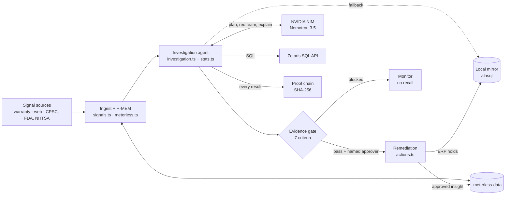
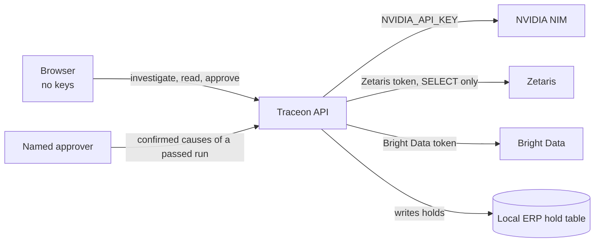
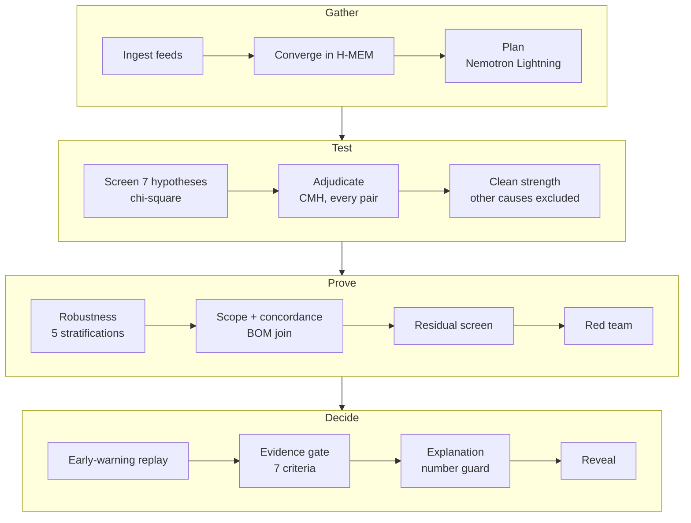
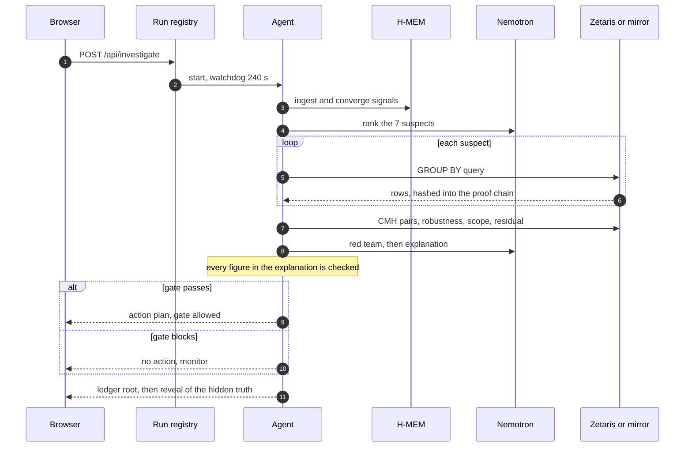
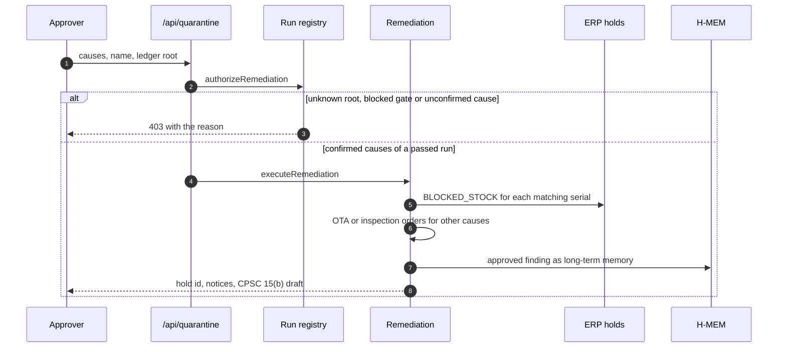
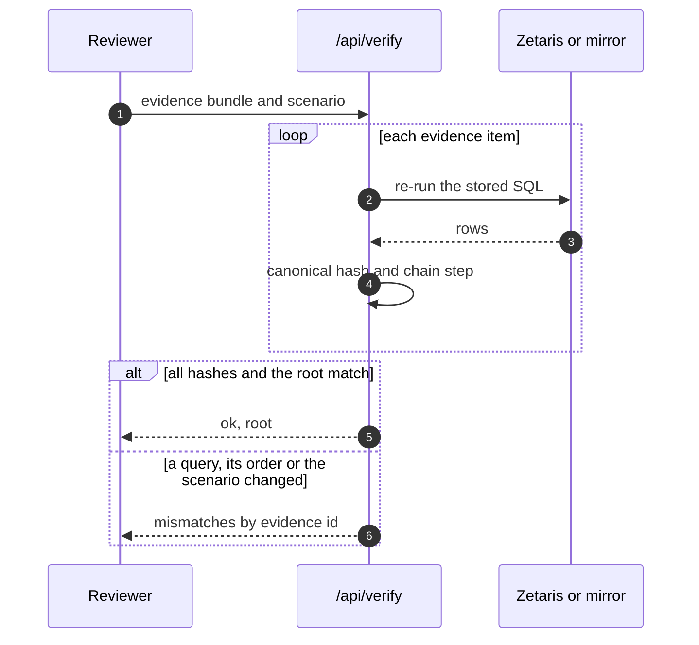
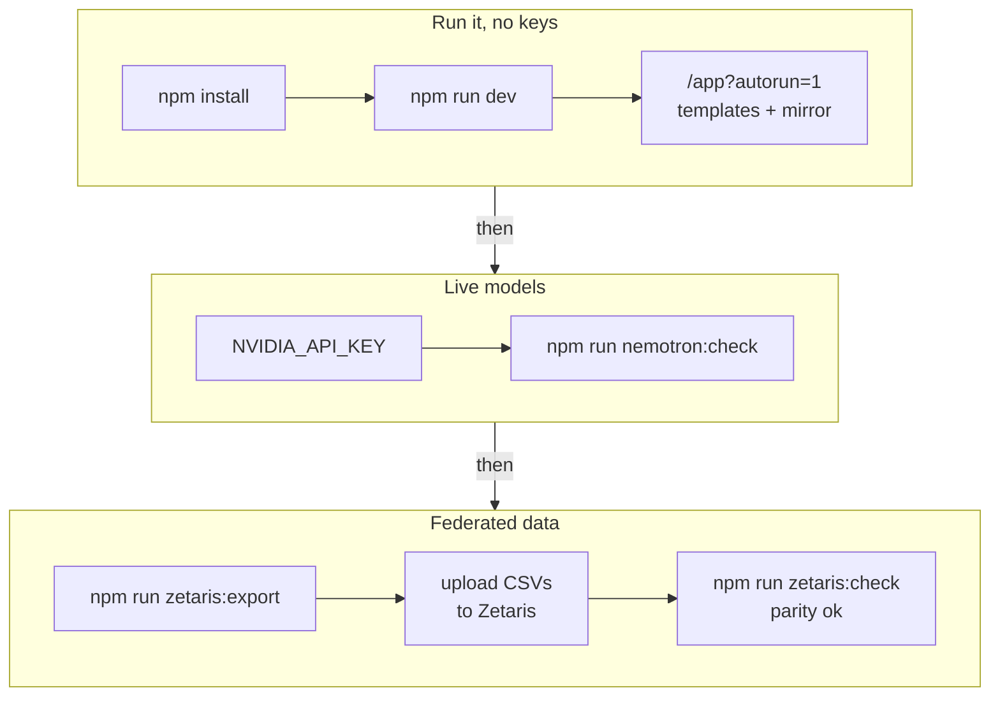

# Traceon

**Traceon is an AI investigator for product-safety teams: it finds the root cause of a defect, proves why every other explanation is wrong, and only then lets a named person quarantine the exact units at risk.**

It pulls scattered warning signs (warranty claims, reviews, federal safety reports) into one case, tests seven suspects against 180,000 units of factory data with federated SQL, separates real causes from look-alikes with stratified statistics, and hashes every query into a replayable proof. Everything is judged by one test: **does it name exactly the hidden cause, and act only when there is one?** On 250 held-out hidden scenarios it did, 250 times. Replayed on real public complaint data, the same kind of test flags the Chevrolet Bolt EV battery-fire signal 14 days before GM's recall.

Built for the Open Agent Hackathon 2026, Track 02 (The Agent That Can Explain Why) · **The company and its factory data are fictional** · App: [traceon.netlayerlabs.com](https://traceon.netlayerlabs.com) · Demo: `<VIDEO_URL>` · Code: [github.com/NetLayerLabs/Traceon](https://github.com/NetLayerLabs/Traceon) (private, access on request) · Team: NetLayer Labs

**Judges, start here:** open `/app?autorun=1` for a full investigation in about 30 seconds with no login, then `/app?scenario=random&autorun=1` to watch it solve a cause it has never seen, and `/backtest` for real recalls. The design is in **[ARCHITECTURE.md](ARCHITECTURE.md)** and the two-minute walkthrough in **[DEMO_SCRIPT.md](DEMO_SCRIPT.md)**.

---

## Judge it in one command (no keys, no accounts, no network)

```bash
git clone https://github.com/NetLayerLabs/Traceon.git && cd Traceon && ./sample.sh
```

Requires Node.js 18.18 or newer. `./sample.sh` installs dependencies on first run, ignores any keys, and runs the real engine end to end in about ten seconds:
- the reference case, with its proof replayed;
- verify-the-fix (the planned fix and the wrong fix);
- five blind scenarios scored against their hidden truth;
- two uploaded CSVs: 355,689 real Backblaze drives, and a generated 12,000-unit set;
- the five real NHTSA backtests.

It writes `sample-output/`: a summary, the event log, the proof bundle, the replay result, the explanation, an 8D report and a supplier claim. It exits non-zero if any result is wrong. `./sample.sh --serve` then starts the full app in the same offline mode on http://localhost:3000.

In sample mode the model steps use labelled templates and queries run on the local SQL engine. Every statistic, verdict and proof is computed exactly as in live mode. **Live mode** (Meterless Nightshift with Nemotron, Zetaris, live feeds) is shown in the demo video; see [Live access](#live-access).

## Examples: inputs and outputs

Each example below is reproduced by `./sample.sh`. Its full output for this run is committed in [`examples/`](examples/), with the summary in [`examples/SUMMARY.md`](examples/SUMMARY.md).

**1. The reference case: a hidden bad batch** (generated data, planted cause)
- **Input.** 125 thermal warranty claims across 180,000 battery packs. Seven suspects: firmware, carrier, Sun Belt heat, plant, BMS board, cell supplier and cell batch.
- **Output.** The cause is cell batch **CB-B-0917**: relative risk 1,668x, explaining 92.8% of incidents. Heat, plant, BMS board and supplier are all ruled out as confounders. The evidence gate passes 7/7. The action holds **1,380 units instead of recalling 180,000, saving $4,465,500**. 56 exhibits are hashed, and a replay of all 46 SQL queries matches the root.
- **Files.** [explanation](examples/reference/explanation.txt), [8D report](examples/reference/8d-report.html), [supplier claim](examples/reference/supplier-claim.html), [proof bundle](examples/reference/proof-bundle.json), [replay result](examples/reference/verify.json).

**2. A blind test with no defect** (generated data, nothing planted)
- **Input.** About 100 claims scattered across the same 180,000 units, with no real cause.
- **Output.** No suspect survives multiple testing, and the evidence gate **blocks any recall**, avoiding a $4.5M recall that would fix nothing. Five blind scenarios run in sample mode, and 304/304 in the full benchmark.

**3. Real data: every drive in Backblaze's fleet, Q2 2026**
- **Input.** [Backblaze Drive Stats](https://www.backblaze.com/cloud-storage/resources/hard-drive-test-data) reduced to one row per drive: 355,689 real drives and 1,517 failures, with model, data centre and age as suspects. Bundled as [`public/samples/backblaze-drives-q2-2026.csv`](public/samples/backblaze-drives-q2-2026.csv).
- **Output.** The worst model is **HGST HUH721212ALN604**: 180 failures in 9,694 drives, about 4x the fleet. The agent shows that its excess is **confined to data centre sac2**: outside sac2 the model fails at 42/10k against 34/10k for other drives, and sac2's own excess disappears without it. Age is ruled out as a confounder. The gate **blocks a fleet-wide action**: the failures sit in one cohort (that model in sac2), which is where to look next.

**4. Real data: the Chevy Bolt EV battery fires**
- **Input.** 229 public NHTSA complaints against 15,774 complaints for ten comparator vehicles.
- **Output.** The fire signal fires on **30 October 2020**, 14 days before GM's recall 20V701000 on 13 November 2020. Across the five bundled vehicles it comes first on three (Bolt EV 14 days, Kia Sorento 72, Hyundai Santa Fe 380), shows no signal on the Kona Electric, and comes after the recall on the Ford Escape.
- **After the recall.** The same data verifies the fixes. GM's first remedy (20V701000, a software update) **did not hold**: fires continued, and a second recall followed. The battery replacement (21V560000) **held**: no fire complaints in the year from 90 days after it, against 5 in the year before (p = 0.031), while owners kept filing other complaints.

## Five things to try, no login or key needed

| Feature | What it is | Try it |
| --- | --- | --- |
| **Investigate** | 131 weak signals from six cities converge in Meterless H-MEM (hierarchical memory) into one incident cluster. Seven suspects (firmware, carrier, Sun Belt heat, plant, battery-management board, cell supplier, cell batch) are each tested with a federated SQL query and a chi-square test. The verdict: cell batch `CB-B-0917` in lot L-409, failing at 841 per 10,000 units against 0.5 elsewhere, a relative risk of 1,668×. | `/app?autorun=1` |
| **Explain why** | Heat, the plant, the BMS board and the cell supplier all look guilty on raw data. A Cochran–Mantel–Haenszel test (a test that holds a second factor fixed) shows each effect vanishes once the batch is held fixed: heat goes from p = 1.6e-6 to p = 0.23. Every node in the proof graph opens its exhibit: the SQL, where it ran, the rows and the proof hash. *In our live runs, Nemotron's first guess was one of these look-alikes. The statistics overruled it, and the agent trace says so.* | Select any node in Fig. 1, or flip **Hold cell batch fixed** on `/` |
| **Blind test** | Pick a hidden scenario: a firmware bug, a bad plant, transit damage, faulty BMS boards, two causes at once, or no defect. The agent investigates without the answer; the planted truth is revealed only after its verdict. With no defect, it finds nothing and **refuses to recall**. | `/app?scenario=random&autorun=1` · `/app?scenario=noise&autorun=1` · `/app?scenario=two-causes&autorun=1` |
| **Act** | A seven-criterion evidence gate must pass before any action appears. A named approver then places an ERP hold on exactly 1,380 serials (SN-88400 to SN-89779) instead of recalling 180,000, saving $4,465,500 at $25 a unit, and Traceon drafts a stop-sale notice and a CPSC Section 15(b) report draft. Firmware causes get an over-the-air rollback instead of a quarantine. | Disposition pane: type a name, **Execute remediation** |
| **Verify** | **Replay & verify** re-runs every SQL query in the case and rebuilds the SHA-256 chain. A tampered query, reordered evidence or the wrong scenario all fail. | Disposition pane: **Replay & verify**, or **Export proof bundle** |

### More to explore

| Feature | What it is | Where |
| --- | --- | --- |
| **Red team** | Nemotron Lightning attacks the verdict. Each objection is mapped to a deterministic check (confounding, geography, exposure time, chance, granularity, subgroups) and answered by it, or logged as an open question when the data cannot test it. | Investigation pane, Red team |
| **Early-warning replay** | The claim history replayed day by day: the batch became statistically detectable on Oct 10 after 3 claims, and 113 later incidents came after that point. | Investigation pane, Early-warning replay |
| **Subgroup table** | The cause's relative risk re-measured inside every firmware, carrier, climate, BMS and warehouse subgroup, shaded by effect size. | Investigation pane |
| **Defect photo** | Nemotron Super VL inspects a customer photo, names the failure mode and component, and draws a bounding box. Upload your own. | Intake pane, Visual evidence |
| **Fact-checked explanation** | The written explanation is checked figure by figure against the evidence; the badge reads, for example, "16/16 figures verified". | Investigation pane, Explain why |
| **Memory across sessions** | After an approval, the finding becomes long-term H-MEM memory. The next investigation recalls it. | Intake pane, H-MEM convergence |
| **Health check** | Query engine, storage, live feeds, models and any active run. | `/api/health` |

### Beyond one case

The app's top bar has a section menu: **Case file**, **Watch**, **Real recalls**, **Your data** and **Scoreboard**. Tools that work on a finished case sit next to the evidence they use.

| Feature | What it is | Where |
| --- | --- | --- |
| **Real-recall time machine** | Public NHTSA complaint histories replayed day by day through a standard safety-signal test (proportional reporting ratio against ten comparator vehicles). The Bolt EV battery-fire signal fires on Oct 30, 2020, 14 days before recall 20V701000; Kia Sorento 72 days early and Hyundai Santa Fe 380 days early. Kona Electric shows no signal and on the Ford Escape the recall came first, both reported as they are. Any other vehicle can be replayed live. | `/backtest` |
| **Watch** | The warranty stream screened every day across every factor. On the reference data the screen fires on Oct 11 after 13 claims, and the case it opens on that day's data confirms the batch. With no defect it never fires. | `/watch` |
| **Your data** | Upload a CSV, map the failure column and the suspects, and investigate it with the same tests and gate. Checks the data cannot support are marked N/A instead of passed. Two bundled samples: 355,689 real Backblaze drives from Q2 2026, and a generated 12,000-charger set whose planted resin lot is found with its night-shift confounder ruled out. | `/data` |
| **Ask the case** | Questions answered only from the case's exhibits, with each claim citing its exhibit and every figure checked by the number guard. Citations open the exhibit. | Investigation pane, Case tools |
| **What if** | Sliders that re-run the statistics in the browser: act on an earlier day, shrink the defect, or keep less of the data, and see whether the verdict still holds. | Investigation pane, Case tools |
| **What would prove this wrong** | Four conditions, fixed before any fix is applied, that would overturn each cause: the baseline rate outside it, its failure signature, its weakest subgroup, and anything new in the residual. | Investigation pane |
| **Uncertainty** | A forest plot of every suspect's relative risk with its 95% interval, intervals on the cause's rate and share, and a 90% range on the 30-day projection. | Investigation pane |
| **Verify the fix** | Thirty simulated days after the fix, checked against the falsifiers. The planned quarantine is verified; acting on the leading confounder instead (a Sun Belt heat advisory) reopens the case. | Disposition pane, after approval |
| **8D report and supplier claim** | Printable documents in which every claim cites its exhibit, closed by the exhibit index and the proof root. | Disposition pane, Reports and review |
| **Reviewer mode** | A read-only case link. Reviewers open every exhibit and pin comments to it. | Disposition pane, **Share for review** |
| **Signed timestamp** | The ledger root signed with Ed25519 and anchored in Bitcoin through OpenTimestamps. The `.ots` file verifies with the standard `ots` client. | Disposition pane, Proof ledger |
| **Scoreboard** | Nemotron's first-ranked suspect against the tested verdict, and on generated data, who was right. | `/scoreboard` |

The landing page (`/`) reads like an investigation report, with an animated proof figure, the interactive confounder experiment and the blind-test results. The app (`/app`) is a three-pane case file: **Intake**, **Investigation**, **Disposition**. The top bar shows which integrations are live, a scenario picker and **Reset demo**. On phones and tablets (900 px and below) the panes become tabs under a sticky top bar, the controls move into a left drawer, the proof graph scrolls sideways, and exhibits open as a full-screen sheet. There is no login.

## Why the statistics, not the model, have to decide

A language model can sound certain about a correlation. A recall decision has to survive a regulator, a supplier and a lawyer.

- **No adjustment, no explanation.** Raw data blames five suspects. Only `cochranMantelHaenszel()` in `src/lib/stats.ts`, applied pairwise in `src/lib/investigation.ts`, separates the one real cause from four look-alikes.
- **No deterministic statistics, no trust.** Every p-value, rate and dollar figure is computed in `src/lib/stats.ts` and checked against scipy and statsmodels in `tests/stats.test.mts`. The model only plans, objects and writes, and `numberGuard()` checks its prose.
- **No proof chain, no audit.** Each query result is hashed over canonical rows and chained (`ProofChain` in `src/lib/investigation.ts`); `verifyLedger()` in `src/lib/actions.ts` replays it.
- **No gate, no action.** The gate's seven criteria are computed in `runInvestigation()`, and the server refuses a remediation for any run whose gate failed or for any cause it did not confirm (`authorizeRemediation()` in `src/lib/runRegistry.ts`).
- **No blind tests, no claim of generality.** `scripts/eval.mts` scores the agent on hidden scenarios it was never told about.

## Architecture

Traceon has five layers in one Node.js process:
- **Signals:** warranty claims, reviews and forums, and live federal feeds.
- **Context:** Meterless H-MEM stores and converges signals; the Markovian engine bounds the investigation chain.
- **Reasoning:** Nemotron plans, red-teams, inspects photos and explains; the statistics engine decides.
- **Data:** federated SQL through the Zetaris SQL API, with a local mirror as a labelled fallback.
- **Action:** the evidence gate, the named approver, remediation and the proof chain.

The full design, file by file, is in **[ARCHITECTURE.md](ARCHITECTURE.md)**.

### System overview



Signals flow left to right into the agent, which reaches out to Nemotron for language tasks and to Zetaris for data, falling back to the local mirror with the reason recorded. Every result lands in the proof chain. Only a passed gate and a named approver lead to action; a blocked gate means monitoring, not a recall.

### Who holds which key



| Key or role | Lives in | Can | Can never |
| --- | --- | --- | --- |
| `NVIDIA_API_KEY` | Server environment only | Call NIM chat completions for planning, red team, vision and the explanation | Reach the browser, produce a statistic, or trigger an action |
| Zetaris token or login | Server environment only | Send `SELECT` queries through the SQL API | Write to Zetaris: the app sends no write statements; holds go to the local ERP table |
| `BRIGHTDATA_API_TOKEN` | Server environment only | Fetch public news pages through the Web Unlocker (at most once per 30 minutes) | Reach the browser |
| Named approver | Typed in the browser | Approve the confirmed causes of a completed run whose gate passed | Act on a blocked run, an unconfirmed cause or an unknown ledger root (403) |
| Anyone with the URL | Browser | Run investigations, open exhibits, replay proofs, reset the demo | Start a second run while one is active (409) |

### The investigation pipeline



The Bonferroni-corrected significance level is 0.01 divided by 7. A suspect survives only if it stays significant when every other suspect is held fixed, paying a multiplicity correction for being picked as the worst of its groups. Each surviving cause is then measured with the other causes' units excluded, so two real causes cannot inflate each other. The residual screen re-tests everything with the confirmed causes removed: if any structure remains, the gate blocks.

### One investigation, end to end



Events stream to the browser as they happen. If the stream drops, the browser catches up from the run's event log; if another run is active, it attaches to that run instead.

### Acting on a verdict



The hold id is a hash of the scenario, ledger root and causes, so approving twice reports "already in place" instead of duplicating 1,380 rows.

### When the proof fails



`tests/proof.test.mts` checks four tamper cases: an edited query, swapped evidence, dropped evidence, and a ledger checked against the wrong scenario.

### From clone to live integrations



Each step is optional. Without keys every model step uses a labelled template and every query runs on the local mirror; the statistics, verdicts and proofs are identical.

**A verifiable end-to-end example.** `npm test` runs the reference investigation and asserts the result: cell batch `CB-B-0917` confirmed; heat, plant, BMS board and cell supplier marked as confounders; firmware and carrier ruled out; 1,380 units affected; $4,465,500 saved; the evidence gate passed; and the hidden truth matched. It then replays the ledger and holds the 1,380 serials. See [test status](#test-status) for the latest run.

## Safety

- **The model never decides.** Nemotron plans the order of tests, raises objections and writes prose. Every statistic, every verdict and every gate criterion is computed in code, and `numberGuard()` flags any figure in the prose that is not in the evidence.
- **The gate is enforced twice.** The UI shows the remediation control only after all seven criteria pass, and `/api/quarantine` refuses (403) any request whose ledger root does not belong to a completed run that passed, or that names a cause the run did not confirm.
- **Input protection.** Every query passes a read-only check before it runs (a single `SELECT`, no `INTO`, no file functions), so even a replayed proof bundle cannot write files or change data. Only confirmed cause columns are actionable and values are SQL-escaped; uploaded values with backslashes or control characters are refused. Request bodies are validated (bad input gets a 4xx, never a crash). Vision accepts only `data:image/` URLs under about 6 MB, and an investigation uses a photo finding only by the id the server issued for it.
- **Proof covers what people read.** Each chain step hashes the exhibit's content, label and summary, and **Replay & verify** replays what the server recorded and compares the rebuilt root with the one it published.
- **One investigation at a time.** A second start gets 409 and can attach. A watchdog ends a run after 240 seconds (`RUN_TIMEOUT_MS`); the lock is released once the timed-out run has actually stopped.
- **Every external call has a deadline.** Federal feeds 9 s; Zetaris 55 s to start a query and 30 s per page, with two retries for known transient cluster faults and a 60 s circuit breaker after repeated failures; Nemotron 20 to 75 s depending on the call, capped by `NEMOTRON_TIMEOUT_MS`; thinking requests race a fast answer so latency spikes never stall a run.
- **Nothing is faked when it fails.** An unreachable feed is shown as unreachable; a Zetaris failure falls back to the mirror with the reason in the exhibit; a model failure falls back to a labelled template with the reason in the agent trace.
- **Open by design for judging.** There is no login. `/api/reset` clears demo memory and holds (shared cases, uploads and the signing key are kept); set `TRACEON_DISABLE_RESET=1` to turn it off. Put the app behind authentication before any real use.
- **Shared data is not private.** Uploaded datasets, shared cases and their comments are stored on the server as plain JSON and are readable by anyone with the link.
- **Test coverage.** 67 tests: statistics against scipy and statsmodels (7), blind scenarios (6), proof and remediation (6), degradation (5), the run registry (2), a real production server end to end (5), the features built on a finished case and the real-data feeds (18), regressions for every fix from the end-to-end audit (7), Zetaris fault handling and session refresh (4), and Meterless Nightshift as the AI provider (7).

## What's real and what's simulated

| Real | Simulated or local |
| --- | --- |
| CPSC, openFDA and NHTSA data, fetched live on each run | The company (VoltRide), its 180,000 units, lots, suppliers, warehouses and warranty claims |
| Meterless Nightshift as the AI provider, running on the Mac: planning, red team and Q&A go through it to Nemotron 3.5 Lightning, the explanation to Nemotron 3 Ultra. Each reply is labelled with the route that answered | Reviews and forum posts about the VR-48: the product is fictional, so they are simulated and labelled *simulated* |
| Nemotron on NVIDIA NIM directly: the photo (Super VL, which Nightshift does not serve yet), the fallback when Nightshift cannot answer, and the hosted site, with reasoning traces when thinking wins the race | n/a |
| Bright Data Web Unlocker fetching current news on e-bike battery fires (Google News), shown as live context in the intake | n/a |
| Every statistic, verdict, gate decision and proof hash | The planted causes in each scenario (the agent is never told them) |
| The Meterless H-MEM and Markovian engines, running locally | The ERP hold table, stop-sale notice, OTA order and CPSC draft: written locally, never sent to any ERP, distributor or regulator |
| The Zetaris platform (the hackathon's Docker distribution) answering the reference case's 46 queries over its REST API, with a hash-parity check | Other scenarios and uploads run on the local alasql mirror, labelled in each exhibit; without Zetaris configured, everything does |
| Your own CSV on **Your data**, and the bundled Backblaze sample: 355,689 real drives from Q2 2026 (public Drive Stats) | The second sample there, 12,000 chargers (`scripts/make-sample-csv.mts`), generated with a planted cause |
| NHTSA complaints and recalls behind the backtest (snapshots in `data/nhtsa/`, or live), including the check after each recall of whether the fix held | The 30 days after a fix in the case file's **Verify the fix**, drawn from the scenario's own failure rates (the real-data version is under Real recalls) |
| OpenTimestamps proofs from the public calendars, and the Ed25519 signature | Without a model, the photo's analysis is a labelled offline reference, which never counts as evidence in the gate |
| The sample defect photo: a real NTSB evidence photo of the lithium-ion battery from the JAL Boeing 787 that went into thermal runaway at Boston on 7 January 2013 (public domain), analysed live by Nemotron | It stands in for a customer's photo: it is not a VoltRide pack, and the app says so under the photo |
| The scoreboard, recorded from real runs with Nemotron | Watch mode replays the scenario's history day by day; it does not read a live warranty feed |

## Tech stack

Next.js 15.5 (App Router), React 19.3, TypeScript 5.9, alasql 4.21 (in-process SQL for the federated mirror), Meterless Nightshift (local OpenAI-compatible runtime), NVIDIA Nemotron (`nvidia/nemotron-3.5-lightning-30b-a3b`, `nvidia/nemotron-3-ultra-550b-a55b`, `nvidia/nemotron-3.5-super-vl-120b-a12b`) through Nightshift and NVIDIA NIM, the Zetaris platform REST API, the Meterless H-MEM and Markovian reference engines, Bright Data Web Unlocker, the CPSC SaferProducts, openFDA and NHTSA APIs, `next/font` with Newsreader and IBM Plex, and Node's built-in test runner through tsx.

## Run it locally

**Prerequisites:** Node.js 18.18 or newer (developed on Node 26.5) and npm. No database.

```bash
npm install
cp .env.example .env.local   # every value is optional
npm run dev                  # landing at http://localhost:3000, the app at /app
```

With no keys, everything runs: model steps use labelled templates, queries run on the local mirror, and memory is written to `.meterless-data/`.

| Variable | What it does | Default or when unset |
| --- | --- | --- |
| `NIGHTSHIFT_TOKEN` (or `NIGHTSHIFT_TOKEN_FILE`) | Meterless Nightshift as the AI provider: every model call goes to the local runtime first | Unset: Nemotron on NVIDIA NIM answers directly |
| `NIGHTSHIFT_URL`, `AI_PROVIDER` | Where Nightshift listens; `auto`, `nightshift` or `nim` | `http://127.0.0.1:8088/v1`; `auto` |
| `NIGHTSHIFT_VISION_MODEL`, `_FAST_MODEL`, `_DEEP_MODEL` | The model id Nightshift is asked for, per job | Nemotron if it is connected to Nightshift (Lightning for fast; Super VL, or Ultra while Nightshift holds Super VL back, for deep), else `meterless/vision`, `meterless/fast`, `meterless/deep` |
| `NVIDIA_API_KEY` | Nemotron on NVIDIA NIM: the fallback when Nightshift cannot answer, or the provider when it is not configured | Unset: labelled templates; the statistics are unchanged |
| `NVIDIA_NIM_BASE_URL` | NIM endpoint | `https://integrate.api.nvidia.com/v1` |
| `NEMOTRON_MODEL` / `NEMOTRON_FAST_MODEL` | Vision and explanation model / planning and red-team model | `nvidia/nemotron-3.5-super-vl-120b-a12b` / `nvidia/nemotron-3.5-lightning-30b-a3b` |
| `NEMOTRON_TIMEOUT_MS` | Cap on every model call | No cap beyond each call's own deadline |
| `NEMOTRON_THINKING_DEADLINE_MS` | How long a thinking answer may take before the fast answer is used | 20,000 for the explanation, 25,000 for vision |
| `NEMOTRON_CACHE` | Reply cache in `.nim-cache/` for instant demo re-runs | On; set `off` to always call the model |
| `ZETARIS_API_URL`, `ZETARIS_ORG_ID` | Zetaris SQL API host and organisation | Unset: every query runs on the local mirror |
| `ZETARIS_API_TOKEN`, or `ZETARIS_USERNAME` + `ZETARIS_PASSWORD` | Zetaris authentication (token, or Basic login with automatic refresh) | Required for the cloud path |
| `ZETARIS_SCHEMA`, `ZETARIS_TABLE_MAP` | Where the tables live in Zetaris, for example `traceon`, or a per-table JSON map | Unqualified table names |
| `BRIGHTDATA_API_TOKEN`, `BRIGHTDATA_ZONE` | Live news on e-bike battery fires through the Web Unlocker, shown as real-world context (cached 30 minutes) | Unset: no news feed; zone `web_unlocker1` |
| `OPENFDA_API_KEY` | Higher openFDA rate limits | openFDA works without a key |
| `METERLESS_STORAGE_DIR` | Where H-MEM and the world model persist | `./.meterless-data` (`/tmp/meterless-data` on Vercel) |
| `DEMO_PACING_MS` | Delay between steps so a demo is watchable | 350 |
| `RUN_TIMEOUT_MS` | Watchdog for one investigation | 240,000 |
| `TRACEON_DISABLE_RESET` | Set to `1` on a shared deployment so nobody can clear demo memory | Unset: **Reset demo** works |
| `TRACEON_SIGNING_KEY` | Ed25519 private key (PEM) that signs proof roots, so a deployment keeps one identity | Unset: a key is generated once and kept in the storage folder |

The same list with comments is in [`.env.example`](.env.example).

```bash
./sample.sh                  # sample mode: the whole engine offline, outputs in sample-output/
npm test                     # the full suite, including a production build and server
npm run eval -- 300          # blind accuracy on random seeds 1-300 plus the four named scenarios
npm run nightshift:check     # one real request on each Nightshift job (needs the Nightshift app running and its token)
npm run nightshift:standin   # development stand-in for Nightshift on :8088, labelled as such in the app
npm run nemotron:check       # live check of every Nemotron call (needs NVIDIA_API_KEY)
npm run zetaris:export       # write the five tables as CSV for Zetaris
npm run zetaris:check        # Zetaris connection and hash-parity check
npm run zetaris:warm         # run every reference-case query on Zetaris once (warm the cluster before a demo)
npm run zetaris:mock         # spec-conformant Zetaris test double on :4599
npx tsx scripts/snapshot-nhtsa.mts <raw-dir>   # rebuild the NHTSA backtest snapshots in data/nhtsa/
npx tsx scripts/make-sample-csv.mts             # rebuild the charger sample for /data
```

### Test status

Run on 2026-10-26 (`npm test`, which includes a production build and server):

```
ℹ tests 61
ℹ pass 61
ℹ fail 0
```

Blind accuracy (`npm run eval`): seeds 1-300 re-run on 2026-10-25 at 22:31 UTC after the as-of and uploaded-data changes to the engine; the held-out run is from 21:06 UTC the same day:

```
seeds 1-300 + 4 named:    304/304 correct (100.0%)   wrong but safely blocked: 0 · wrong and acted: 0
held-out seeds 151-400:   250/250 random seeds correct (254/254 including the 4 named)
```

| Planted cause | Seeds 1-300 + named |
| --- | --- |
| Cell batch | 46/46 |
| Assembly plant | 47/47 |
| Firmware release | 36/36 |
| BMS board supplier | 44/44 |
| Carrier | 41/41 |
| Two causes at once | 44/44 |
| No defect | 46/46 |

The method was tuned on seeds 1-150 (three statistical flaws were found and fixed there: sparse tables, post-hoc group selection, and causes contaminating each other). Seeds 151-400 were never used for tuning.

## Roadmap

Status as of 2026-10-26. The pre-submission checklist is in [TODO_BEFORE_SUBMISSION.md](TODO_BEFORE_SUBMISSION.md).

**Done**
- The investigation agent, evidence gate, proof chain and remediation; 304/304 blind scenarios and 250/250 held out.
- Meterless Nightshift as the AI provider, routing to Nemotron (Lightning, Ultra), with Nemotron on NVIDIA NIM for the photo and as the labelled fallback.
- Zetaris live: the reference case's 46 queries on the Zetaris platform with hash parity, deployed at traceon.netlayerlabs.com.
- Real data: 355,689 Backblaze drives, NHTSA backtests with a check of whether each recall's fix held, live CPSC, openFDA and NHTSA feeds, Bright Data news, and a real NTSB photo.
- Before the case: Watch (daily screening that opens a case on alert) and Your data (CSV upload).
- In the case: Ask the case, What if, What would prove this wrong, and intervals throughout.
- After the verdict: Verify the fix, 8D report, supplier claim, reviewer mode, and a signed OpenTimestamps root.
- Outside the simulation: the real-recall backtest on five NHTSA vehicle histories, and live for any vehicle.
- Scoreboard of model guesses against tested verdicts.

**Next, before submission**
- Record the demo video and submit on HackOS.

**Later**
- Authentication and per-team storage for uploads, shared cases and comments.
- Real follow-up on arriving claims for uploaded data, with the reopened case triggered automatically (the NHTSA recalls already have it).
- The photo through Nightshift once it serves a Nemotron vision model.
- Watch mode on a live warranty feed, and continuous factors (temperature, charge cycles) alongside categorical ones.
- Upgrading OpenTimestamps proofs once Bitcoin confirms them, and verifying them in the app.

## Live access

The live deployment is at **https://traceon.netlayerlabs.com** and stays running until the results are announced on **6 November 2026**. It is configured as follows:
- **Data:** the Zetaris platform (the hackathon's Docker distribution) runs on the same server, and the reference scenario's queries go to it over the Zetaris REST API. The top bar shows the hash-parity check; other scenarios and uploads run on the local engine, labelled in each exhibit. A full reference investigation takes about 15 seconds, with all 46 queries on Zetaris.
- **AI:** Nemotron on NVIDIA NIM. Meterless Nightshift is a desktop runtime (Mac, Windows, DGX), so it cannot run on this Linux server. The demo video shows the same app on a Mac with Nightshift as the AI provider: planning, red team and Q&A go through it to Nemotron Lightning, the explanation to Nemotron Ultra, and a full case takes about 18 seconds. To try that path yourself, install Nightshift (free Mac M1+ edition from meterless.ai), add an NVIDIA key under Setup → Cloud provider keys, set `NIGHTSHIFT_TOKEN_FILE` to its `runtime-token` file and run `npm run nightshift:check`.
- **Feeds:** CPSC, openFDA and NHTSA, fetched live, and Bright Data news through the Web Unlocker.

If any live service is unavailable, the app says so in each exhibit and in the top bar, and falls back without changing a verdict. The sample mode above needs none of it.

## Deploying

1. **Host on one long-running Node server** such as Railway, Render or Fly. The mirror, the ERP holds and the run registry live in process memory, so serverless platforms that spread requests across instances would lose them. `npm run build && npm start`.
2. **Persist two folders** on a volume: `.meterless-data/` (or `METERLESS_STORAGE_DIR`) for memory, and `.nim-cache/` for instant demo re-runs.
3. **Set the environment** from the table above. Point the host's health check at `/api/health`, which returns 200 when the core works and 503 when it does not.
4. **Zetaris (optional).** Create a cluster, run `npm run zetaris:export`, upload the CSVs to a database named `traceon`, set the Zetaris variables, and confirm `npm run zetaris:check` prints `parity OK`. Step by step: [docs/ZETARIS_SETUP.md](docs/ZETARIS_SETUP.md).
5. **Warm the cache before recording.** Run each scenario once with `NEMOTRON_THINKING_DEADLINE_MS=60000` so the cache holds answers with thinking traces.
6. **Live URL:** https://traceon.netlayerlabs.com (one Ubuntu server: Traceon under pm2 behind nginx with a Let's Encrypt certificate, Zetaris in Docker on localhost-only ports with memory caps).

## Repository map

```
src/app/page.tsx              landing page (/), report style, with the confounder experiment
src/app/landing.css           landing styles, motion and the mobile drawer
src/app/app/page.tsx          the case file (/app): three panes, section menu, scenario picker, stream recovery, mobile tabs
src/app/watch/                watch mode (/watch)
src/app/backtest/             real-recall time machine (/backtest)
src/app/data/                 bring your own data (/data)
src/app/scoreboard/           model against statistics (/scoreboard)
src/app/case/[id]/            reviewer mode: a shared, read-only case with comments
src/app/globals.css           design system: paper, ink, one signal colour; responsive rules
src/app/layout.tsx            fonts (Newsreader, IBM Plex Sans and Mono)
src/app/api/                  investigate, signals, vision, quarantine, verify, status, reset, health,
                              backtest, datasets, watch, ask, counterfactual, followup, report, cases, proof, scoreboard
src/lib/enterpriseData.ts     the fictional company, 180,000 units and the planted scenarios
src/lib/stats.ts              chi-square, Monte Carlo exact test, Cochran–Mantel–Haenszel, relative risk
src/lib/investigation.ts      the agent: screen, adjudicate, robustness, residual, red team, gate, explanation
src/lib/zetaris.ts            Zetaris SQL API client, canonical proof hashes, local mirror, parity check
src/lib/meterless.ts          H-MEM ingestion and convergence, world model, Markovian chain
src/lib/nemotron.ts           NVIDIA NIM client: thinking race, retries, cache, de-duplication
src/lib/vision.ts             defect-photo forensics
src/lib/signals.ts            federal feeds, Bright Data news, warranty claims, simulated VR-48 chatter
src/lib/actions.ts            remediation and proof replay
src/lib/runRegistry.ts        one-run lock, watchdog, event log, server-side gate check
src/lib/singleton.ts          process-wide state shared by every route
src/lib/scenarioOptions.ts    the scenario menu
src/lib/caseView.ts           a finished case rebuilt from its event log, shared by the tools below
src/lib/realRecall.ts         NHTSA disproportionality backtest
src/lib/datasets.ts           CSV upload, mapping and the uploaded-data mesh
src/lib/watch.ts              daily screening replay
src/lib/ask.ts                grounded Q&A with exhibit citations
src/lib/counterfactual.ts     inputs for the what-if simulator
src/lib/followup.ts           verification after the fix
src/lib/reports.ts            8D report and supplier dispute packet
src/lib/stamp.ts              Ed25519 signature and OpenTimestamps
src/lib/cases.ts              shared cases and reviewer comments
src/lib/scoreboard.ts         model guesses against tested verdicts
src/components/               proof graph, panes, exhibits, case tools, section menu, landing motion, confounder table, landing nav
data/nhtsa/                   NHTSA complaint and recall snapshots for five vehicles
tests/                        stats, scenarios, proof, degrade, registry and end-to-end suites; scipy fixtures
scripts/                      eval, nemotron-check, zetaris export, check and mock, NHTSA snapshots, sample CSV
vendor/                       Meterless H-MEM and Markovian reference engines (Apache-2.0)
public/samples/               the sample defect photo (NTSB, public domain; the earlier illustration is kept as SVG/PNG) and the charger CSV
public/brand/                 the Traceon lockup (footer) and header logo
src/app/icon.png              favicon (apple-icon.png for iOS)
docs/                         Zetaris setup; the original hackathon plan, archived
ARCHITECTURE.md               the full design
DEMO_SCRIPT.md                the two-minute demo
TODO_BEFORE_SUBMISSION.md     the pre-submission checklist and roadmap
```

## Data and naming

VoltRide, the VR-48 battery pack and all factory, supplier, warehouse and warranty data are fictional and generated by `src/lib/enterpriseData.ts`. No real company's data is used or implied. The federal data comes from public U.S. government APIs. The Section 15(b) report is a draft for counsel and is never sent anywhere. The sample defect photo is a real NTSB evidence photo of a different product (a Boeing 787 lithium-ion battery, 2013), used to show the photo analysis on genuine damage; it is labelled as such in the app.

## Pre-existing work and credits

- **Meterless H-MEM and Markovian reference engines**, vendored unmodified from [Meterless/Meterless](https://github.com/Meterless/Meterless) under Apache-2.0 (`vendor/README.md`).
- **alasql** (MIT) for the in-process SQL mirror. Other open-source packages are listed in `package.json`.
- **Sample defect photo:** ["1-7-12 JAL787 APU Battery"](https://commons.wikimedia.org/wiki/File:1-7-12_JAL787_APU_Battery.JPG), National Transportation Safety Board, public domain (U.S. government work), via Wikimedia Commons.
- **Fonts:** Newsreader, IBM Plex Sans and IBM Plex Mono (SIL Open Font License), served through `next/font`.
- **APIs and data:** NVIDIA NIM, the Zetaris SaaS SQL API (built from its published OpenAPI spec), Bright Data Web Unlocker, CPSC SaferProducts, openFDA and NHTSA.
- **Statistics reference values** generated with scipy 1.18.1 and statsmodels 0.15.0.
- **No prior Traceon code.** The configuration was written by hand (no `create-next-app` template), and everything else was written for the Open Agent Hackathon 2026.

## License

There is no license file for Traceon's own code yet. The vendored Meterless engines are Apache-2.0.

---

Traceon is an Open Agent Hackathon 2026 project. VoltRide and its data are fictional. Results come from simulated enterprise data and are a demonstration of method, not advice about any real product or recall.
